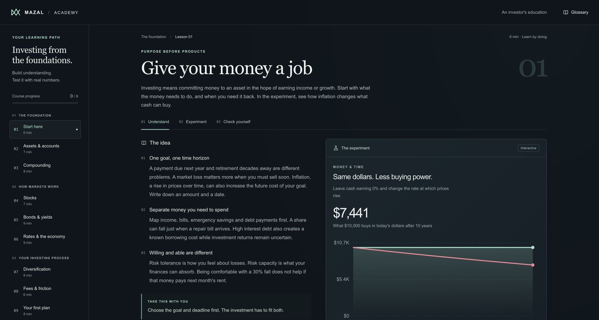

# Mazal Academy

An interactive finance-learning app with nine lessons, quizzes, a glossary, a notebook, and calculation labs. React and TypeScript render the learning interface; IndexedDB keeps progress and notes in the browser.

[Engineering notes](ENGINEERING.md) trace calculation inputs, cross-tab edits, and reset recovery.

[Product portfolio](https://github.com/hxssank/recruiter-portfolio)



*Fresh browser preview with zero completed lessons and the built-in hypothetical example.*

## Explore the product

- Change inflation, contribution, return, and time assumptions in the learning labs and inspect how the calculated results change.
- Compare bond prices, valuation assumptions, fee drag, and weighted portfolio scenarios.
- Complete quizzes, keep lesson notes, and build a practice plan.
- Continue across tabs without one tab silently replacing another tab's independent edits.

This application is separate from the Mazal finance ledger. It uses learning scenarios and does not require bank records or account credentials.

## Engineering decisions

The numerical functions live in [shared/learning.ts](shared/learning.ts), outside the React components. They validate finite inputs and supported horizons before calculating results. This makes the same calculations testable without rendering the interface.

[Progress storage](src/academy/progress-storage.ts) uses IndexedDB transactions and field-level merges. [Session handling](src/academy/progress-session.ts) and [the browser-record hook](src/academy/useBrowserRecord.ts) handle updates, migrations, and reset behavior. Storage tests exercise independent changes from multiple tabs and recovery of in-progress edits.

## Code worth reviewing

| Area | Start here |
| --- | --- |
| Lessons, glossary, and references | [curriculum.ts](src/academy/curriculum.ts) |
| Interactive labs | [LearningLabs.tsx](src/academy/LearningLabs.tsx) |
| Financial calculations and invalid inputs | [learning.ts](shared/learning.ts), [calculation tests](shared/learning.test.ts) |
| Cross-tab progress and reset behavior | [storage tests](src/academy-storage.test.ts), [UI tests](src/academy-progress-ui.test.ts) |

## Run locally

Use Node 24 within the range declared in [package.json](package.json).

```sh
npm ci
npm run dev
```

For the test suite and production build:

```sh
npm run check
npm run preview
```

Open the local URL printed by Vite. Progress belongs to the current browser origin; a different host or port has separate storage.

## Validation

All 29 existing tests, TypeScript checking, and the Vite production build passed on November 9, 2026 after a clean `npm ci` with Node 24.22.0. The tests cover calculations, IndexedDB updates, migrations, draft recovery, and reset behavior. A browser walkthrough was not part of this check.

## Scope

The labs demonstrate simplified financial models. A calculated scenario is not a prediction or an investment recommendation. There is no brokerage connection, user-account backend, or server-side progress sync. Browser storage can be removed by the user or browser, so it is not a durable account backup.
